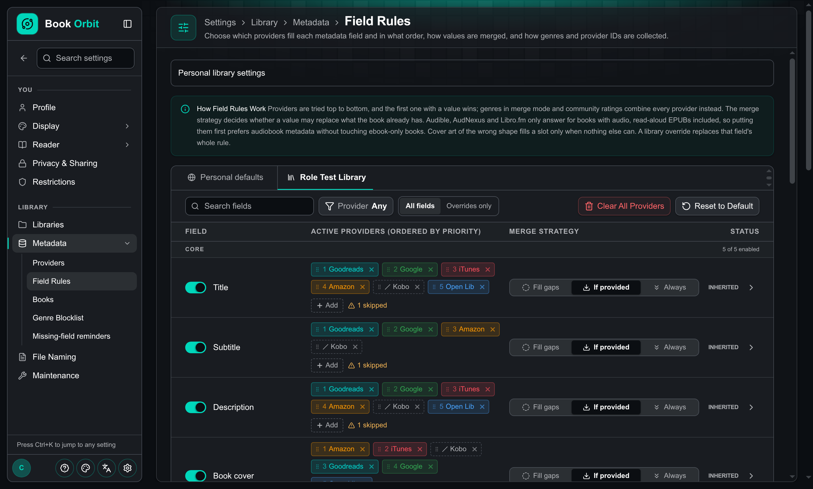
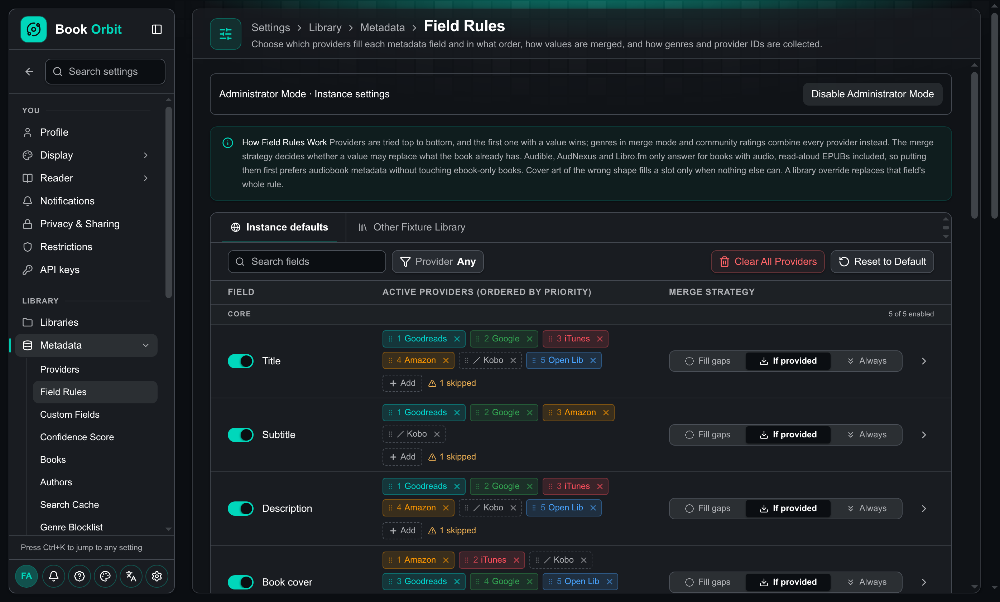
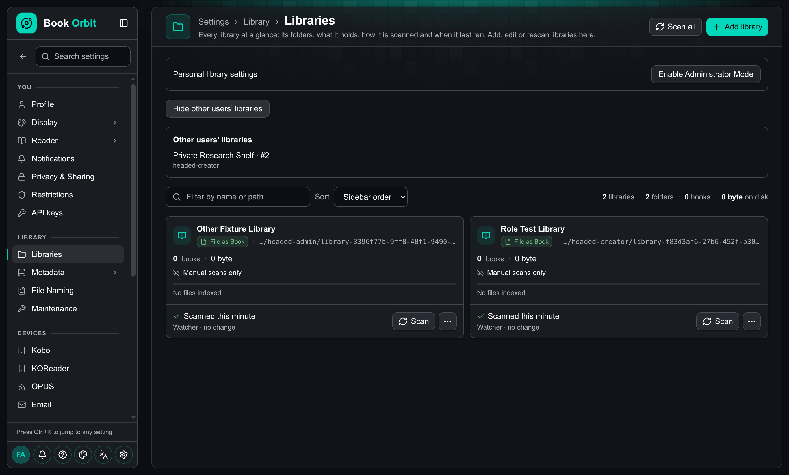
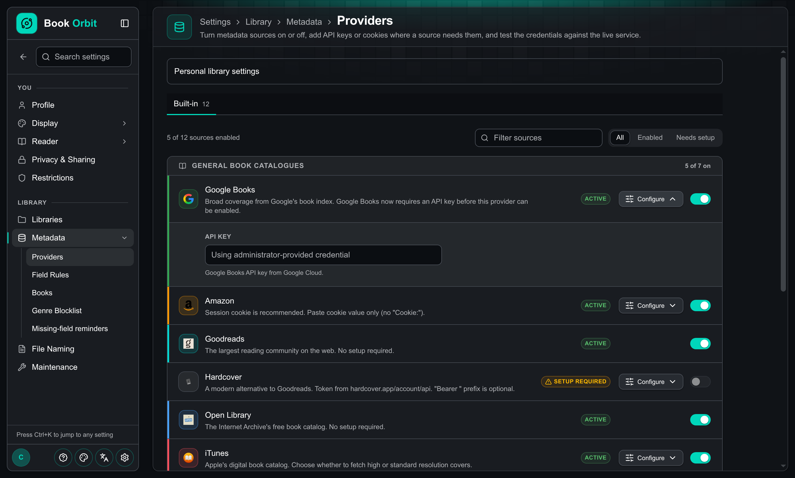

# Library settings and provider credentials

Settings → Library opens in personal mode. The Libraries page shows libraries you have access to. Your role determines which settings and maintenance actions are available. An eligible superuser can enable Administrator Mode for instance settings. Switching accounts or leaving the Library settings section resets the mode.

A superuser can explicitly show other users’ libraries from the Libraries page. This inventory includes library names and owners. It does not add a content grant. Editing a library through the inventory requires Administrator Mode.

## Configuration ownership

BookOrbit resolves settings in this order where applicable.

1. The library’s own override.
2. The personal default of its configured owner.
3. The instance default.

For a new library, BookOrbit records the creator as its configuration owner. Migration 0162 records the existing owner for legacy libraries with exactly one owner. Legacy libraries with zero or multiple owners use instance defaults. Adding another owner leaves the original configuration scope in place. If the configured owner’s owner grant is removed or the account is deleted, the library falls back to instance defaults. Deactivation preserves the binding and owner grant. BookOrbit does not automatically select a replacement configuration owner.

Interactive metadata operations associated with a book and background enrichment associated with a library both use the library’s configuration scope. An interactive provider search without a book uses the authenticated account’s settings. An unattended job without a library uses instance defaults.

## Provider credentials

Provider fields are write-only. The settings interface indicates whether a credential is personal, provided by the administrator, or missing. To replace a credential, enter a new value and save. Removing a personal credential restores the corresponding instance credential where one is configured.

New built-in and external provider secrets use the existing encryption key, `BOOK_REQUEST_ENCRYPTION_KEY`. Previously stored built-in credentials still work and remain write-only until replaced. Back up the encryption key separately from the database so credentials can be recovered after a restore.

A personal Amazon cookie is optional. The instance cookie is inherited only when the personal configuration uses the same Amazon domain. Personal Authorization headers for external providers are attached only to the administrator-registered provider URL they were saved for. Configuring the external provider URL and instance activation requires Administrator Mode.

## Maintenance

Personal mode supports scanning owned libraries and adjusting their automatic metadata-fetch rules. Instance defaults, server-update checks, upload limits, shared cache maintenance, global scoring, and all-user jobs are instance controls.

## Upgrading an earlier custom build

Use BookOrbit's migration runner during an upgrade. It recognizes the exact original fork 0145
ledger entry, checks the shared migration base and configuration-owner foreign key, then allows
the pending upstream migrations to run. Migration 0162 preserves existing bindings, including
unbound libraries. The runner reports an error if the old entry and schema disagree.

## Headed Chrome walkthrough

These screenshots use disposable accounts and synthetic library and provider data. For creation-time sharing, multiple source folders and the on/off behavior of Administrator Mode on a library page, see the [animated library demo](PERSONAL_LIBRARY_DEMO.md).

### Personal and instance defaults

Owners can switch between their personal defaults and a library they own. In Administrator Mode, the settings display instance defaults.

### Administrative library discovery

An administrator can reveal the separate inventory. The unshared library appears there while ordinary library access still requires a grant.

### Provider inheritance

An owner sees a status message when a provider uses an administrator-provided credential. Entering a personal credential overrides it. Removing the personal credential restores the inherited one.

