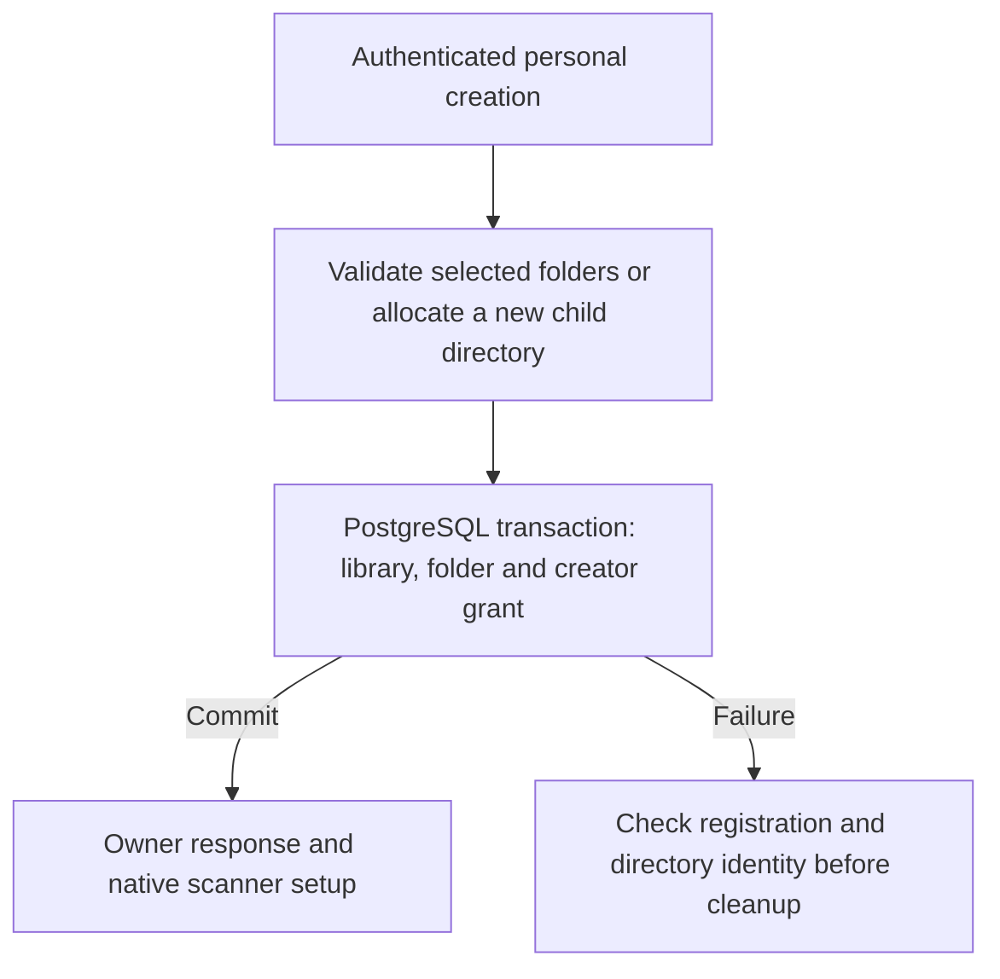

# Personal Libraries

Personal libraries use BookOrbit's existing library, folder, and access tables. A library's storage location determines where its files live. A current library grant determines who can see or use its content. Sharing a library gives access through BookOrbit without opening the owner's personal directory in the folder picker.

## Storage setup

| Setting                 | Default  | Purpose                                                         |
| ----------------------- | -------- | --------------------------------------------------------------- |
| `PERSONAL_LIBRARY_ROOT` | `/books` | Parent directory for user-owned storage.                        |
| `LIBRARY_BROWSE_ROOT`   | `/`      | Outer boundary for personal and administrative storage queries. |

Set both paths from the server's perspective. In a container, mount the persistent books volume at the configured location. The service account must be able to traverse the parent directories and write to the personal storage location. When restricting `LIBRARY_BROWSE_ROOT`, keep the personal parent inside it and review any locations administrators still need to register. Keep personal storage separate from application data and the Book Dock.

Each account has a root named for its immutable username, such as `/books/alice/`. Storage policy rejects empty names, surrounding whitespace, leading dots, path separators, control characters, and names exceeding 255 bytes. Existing accounts with incompatible names can still use granted libraries. Personal storage requires a compatible account name and a safe root.

The first authorized write provisions a missing root. A new root is created with mode `0700` and an exclusive `.bookorbit-owner.json` marker with mode `0600`. Its version and database user ID bind the directory to the account even if a username is later reused. Preserve the marker when backing up or restoring the books volume, and restore it with the database containing the matching user IDs.

### Browsing and registration

- `/api/v1/path` and its folder browsing, inspection, search, and creation operations default to personal storage, including for a superuser. `ManageLibraries` alone does not widen the filesystem scope. Personal browsing excludes system-managed and inaccessible registered directories.
- Deliberate `scope=admin` storage requests require superuser authority and stay within `LIBRARY_BROWSE_ROOT`. Registered directories still honor library grants, and writes inside a registered location require editor access. The path policy also blocks protected system targets. An API key with explicit library bounds cannot use raw storage endpoints.
- The path policy checks lexical and resolved containment, rejects traversal segments, and checks existing ancestors for symbolic links before using a path. Personal creation can register existing subdirectories owned by the caller's personal storage. The service checks the selected paths again while holding the registration lock.
- When registering folders, BookOrbit checks for duplicate, ancestor, and descendant overlaps. New registrations cannot claim a personal root or its namespace parents. Existing folder sets can remain attached to legacy libraries. Changing the registered folders requires explicit administrative filesystem scope.

The storage tree is controlled by the service and its operator. The verified boundary covers BookOrbit users and their API requests. Host processes with write access to ancestors can change the filesystem between checks and operations. Keep those directories under operator control.

See [path controller](../server/src/modules/path/path.controller.ts), [path policy](../server/src/modules/path/path-policy.service.ts), and [personal directory validation](../server/src/modules/path/personal-directory.ts).

### Adopting a legacy directory

An existing unmarked directory, including an empty one, requires explicit adoption. A missing root is available for normal provisioning. A mismatched, malformed, or symlinked marker requires operator investigation.

1. Back up the database and the storage tree. Confirm the existing directory, intended account, contents, and volume permissions. Resolve symlinks, blocked paths, conflicting registrations, or system-managed storage before proceeding.
2. As a superuser, call `POST /api/v1/path/adopt-personal-root` with `{"userId": <target-user-id>}`. BookOrbit derives the directory from the target's stored username. The endpoint binds an existing eligible directory and returns its root path. It leaves a prior marker intact and rejects a conflicting identity.
3. Retry capability discovery as the target user. Adoption binds storage to that account. Use library grants to recover access to any existing registered library.

## Creation, ownership, and recovery

`POST /api/v1/libraries/personal` accepts library settings and an optional `folders` array. When the array is empty or omitted, the server allocates a `library-<uuid>` child. When folders are selected, BookOrbit registers the existing directories in place. The authenticated caller is the creator. `POST /api/v1/libraries?scope=admin` remains available for authorized registration of operator-selected folders. Clients using `POST /api/v1/libraries` without a scope are subject to the default personal path policy and the route's `ManageLibraries` gate. Both creation paths return `accessLevel: "owner"` for the creator.

One PostgreSQL transaction inserts the library, initial folder registrations, and the creator's `owner` row in `user_library_access`. Creation takes an advisory transaction lock and rechecks registered paths and the case-insensitive library name. Names are instance-wide, so a duplicate-name conflict can indicate the name is already in use. Native scan, watcher, and scheduler setup follows the commit. A setup error can leave a valid library needing background setup or a scan retry.



On failed personal creation, the service attempts to remove only the newly allocated empty directory after confirming its filesystem identity and that PostgreSQL has no folder registration for it. The user root, marker, and existing files remain. A crash between allocation and commit can leave an unregistered directory. If the transaction outcome is unclear or the directory contains files, inspect the registration and contents before attempting cleanup.

| Authority                | Ordinary behavior                                                                                         |
| ------------------------ | --------------------------------------------------------------------------------------------------------- |
| `viewer` library grant   | View the library and read content subject to the endpoint's existing permissions.                         |
| `editor` library grant   | Also qualifies for editing operations that require editor access and their associated global permissions. |
| `owner` library grant    | Manage settings, remove the library, and grant or revoke access within that library.                      |
| Global `ManageLibraries` | Use library administration and other endpoints requiring that permission.                                 |
| Superuser                | Enter authorized administrative flows. Ordinary content access still requires a grant.                    |

An owner using a normal session can download, upload, edit metadata, generate read-aloud books, delete, merge and link in libraries they own. Editors use their explicit account permissions and viewers can browse and read. API keys retain their credential permissions and bounds. A manual scan or cover refresh requires explicit `ManageLibraries` and an editor or owner grant, or a superuser session sending `scope=admin`. Use `/api/v1/libraries/:id/assignable-users` and `/api/v1/libraries/:id/access` for sharing. Grant mutations lock the library row, recheck the initiating owner's grant for owner-scoped requests, and reject removal or demotion of the last owner with `409`. Administrative replacement of a user's library grants also protects the last owner. Assign another owner first when transferring ownership.

Legacy libraries may have grants but no owner. Deleting a user can also remove that user's grants through the existing database cascade. Library administration can inventory these libraries through `GET /api/v1/libraries/administration`, including `ownerCount`. From explicit library administration, use `POST /api/v1/libraries/:id/access?scope=admin` with `{"userId": <target-user-id>, "accessLevel": "owner"}` to assign an owner. This configuration and grant recovery path requires `ManageLibraries` or superuser authority and respects key bounds. The inventory and recovery path are separate from ordinary content and from raw filesystem administration.

See [library controller](../server/src/modules/library/library.controller.ts), [library service](../server/src/modules/library/library.service.ts), [library repository](../server/src/modules/library/library.repository.ts), and [access schema](../server/src/db/schema/auth.ts).

## Content visibility and revocation

Ordinary library lists and direct library or book routes resolve the caller's current grants using [LibraryScopeService](../server/src/common/library-scope/library-scope.service.ts) and the domain access checks. Superusers also require a grant, including for legacy or system-managed libraries. Regular API keys inherit the owner's current grants and can narrow them to specific library IDs. Read-only keys cap library access at `viewer`. An administrator-enabled key can perform applicable administrator operations within its credential capabilities. See [API Keys](API_KEYS.md#what-a-key-can-do).

Collections have a separate ownership model. Their owners can modify, reorder, or delete them. Other accounts, including superusers, can read collections designated public. Public collection counts, membership and returned books are scoped to content the reader can access. Individual library grants do not make a private collection public, and public collections cannot grant book access. Per-recipient collection sharing and per-user library ordering are outside the current implementation. See [collection service](../server/src/modules/collection/collection.service.ts) and [collection repository](../server/src/modules/collection/collection.repository.ts).

After revocation, subsequent requests use the new scope. [Statistics](../server/src/modules/statistics/statistics.service.ts) includes the current visible libraries and credential context in cache keys. [Achievements](../server/src/modules/achievement/achievement.service.ts) and [move previews](../server/src/modules/book-move/book-move.service.ts) use grant-aware inputs. [Notifications](../server/src/modules/notification/notification.service.ts) scope reads and mutations, and [notification delivery](../server/src/modules/notification/notification.gateway.ts) checks scope before sending library-specific items. Established [scanner and reading-progress sockets](../server/src/modules/scanner/scan.gateway.ts) reauthenticate and check grants on delivery. Cross-library transfer events can refresh the visible side without naming an inaccessible library. Merge and duplicate job events require access to the involved libraries.

EPUB content responses use `Cache-Control: private, no-store`. Book covers and thumbnails use `private, no-cache` and reauthorize before conditional `304` responses. Revocation controls subsequent access. A previously downloaded copy or a response already delivered to a client cannot be recalled.

## Capabilities API

`GET /api/v1/libraries/capabilities` returns [`LibraryCapabilities`](../packages/types/src/library.ts) for the authenticated credential, with `Cache-Control: private, no-store`.

```json
{
  "canCreatePersonalLibrary": true,
  "personalLibraryDenialReason": null,
  "canUseAdministrativeStorage": false,
  "administrativeStorageDenialReason": "Administrator filesystem scope requires a superuser"
}
```

Each boolean has a corresponding nullable reason. A permitted operation has a `null` reason. Expected policy denials return display text, which clients can display without parsing. Auth failures and unexpected errors use normal HTTP errors. The response carries no storage paths, actor IDs, or library grants. Use `accessLevel` from the ordinary library list for owner controls. `/auth/me` and the library array retain their existing shapes.

| Request context                                     | Personal creation                             | Administrative storage                                                   |
| --------------------------------------------------- | --------------------------------------------- | ------------------------------------------------------------------------ |
| Active user with a missing or correctly marked root | Allowed if storage policy permits it          | Requires superuser authority                                             |
| Unmarked, malformed, mismatched, or unsafe root     | Denied                                        | Evaluated independently                                                  |
| Non-superuser with `ManageLibraries`                | Same personal storage policy                  | Denied                                                                   |
| Demo-restricted account                             | Denied                                        | Denied                                                                   |
| Inactive or unauthenticated account                 | Authentication fails                          | Authentication fails                                                     |
| Read-only or library-bounded API key                | Denied                                        | Denied                                                                   |
| Valid write key with no library bounds              | Same personal storage policy as the key owner | Requires an administrator-enabled superuser key and valid storage policy |

The GET handler evaluates the existing write policy without provisioning a root or marker, changing database rows, or recording API-key last use for this endpoint. Its result reports current eligibility. In particular, discovery does not probe filesystem writes or guarantee a subsequent operation will succeed. Create and other mutation requests validate policy independently.

## Web interface

The sidebar, library index, and dashboard show personal creation based on the capability response. The Folders tab lets the creator choose multiple source folders within their personal storage. Leaving the tab empty requests a new folder. The Access tab lists eligible active users by ID, username, and display name. The form saves the creator's ownership with the library, then submits any queued grants through the existing Access API. It identifies failed grants for retry, and the creator can finish with the grants that succeeded. A user with an owner grant can open the existing settings editor and Access panel. Folder paths are omitted when saving ordinary owner edits.

Creation starts in personal mode. The form can offer **Use administrative storage** when the capability allows it. Turning on administrative storage scopes the native folder picker, prescan, and registration requests with `scope=admin`. On a library page, superusers can select **Enable Administrator Mode** from its actions menu. The active indicator and **Disable Administrator Mode** action apply to that library. Uploads, scans and settings management send explicit administrator intent while active. Ordinary requests use the assigned role, and the mode never grants ownership. The administrative grant-recovery tools remain separately authorized.

While capabilities load or their request fails, creation controls wait for a successful eligibility check. The library index can show a denial reason and retry a failed request. A failed save leaves the form available for correction. On account change the frontend resets library and capability state and ignores late responses from the previous account. See [capability composable](../client/src/features/library/composables/useLibraryCapabilities.ts), [creator modal](../client/src/features/library/components/LibraryCreatorModal.vue), and [library permissions](../client/src/features/library/composables/useLibraryPermissions.ts).

## Compatibility and rollout

This feature adds no database migration. Existing registered paths, books, metadata, and explicit grants are reused. Before rolling out, inventory ownerless libraries and record which readers should retain access. Restore intended grants through explicit administration where users previously depended on implicit superuser access. Review integrations that list or open content as a superuser or through API keys, and grant only the intended libraries. When rolling back to an earlier version with implicit superuser visibility, account for that version's broader visibility even if the database and grants are unchanged. Personal storage is provisioned separately from existing catalog visibility. Book placement, registration, scanning, and reading reuse the native workflows.

Schedule folder rebindings one at a time. Administrative edits validate folder overlaps but use the existing update flow, which does not take the new registration transaction's advisory lock. Concurrent rebindings or a rebind racing a new registration were outside validation.

Background scanner setup and embedded metadata extraction were exercised with native EPUB fixtures in both `book_per_file` and `book_per_folder` modes. External metadata enrichment, the full authorization matrix, headed browser signoff, and the second-device merge fixture have separate verification requirements. See [personal-library verification](TESTING.md#personal-library-verification).
