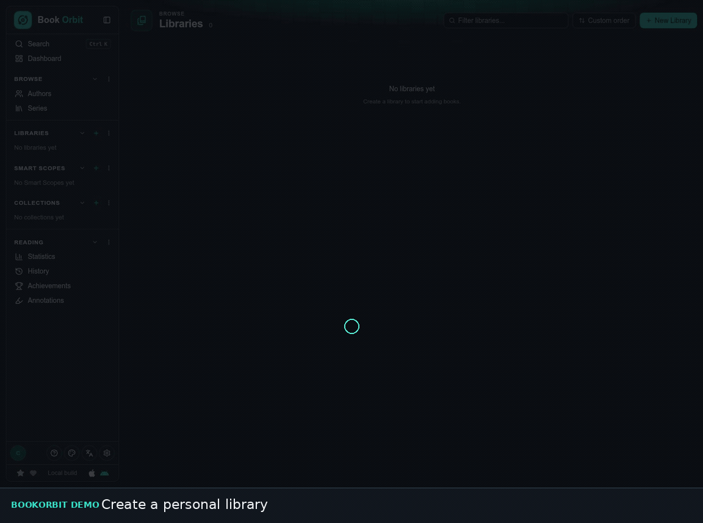

# Personal library sharing and scoped administration

## Create and share a personal library

Open **New Library**, then use **Folders** to select one or more directories inside your personal storage. Files stay in place. Leave the folder list empty to generate a directory automatically. A folder cannot be registered in overlapping libraries.

The creator becomes Owner automatically. Use **Access** to choose additional users and assign Viewer, Editor, or Owner before creating the library. Sharing happens after the library is saved. If an individual grant fails, the dialog keeps it available for retry and preserves the library and successful grants.

Superusers start with personal storage too. **Use administrative storage** explicitly enables the server folder picker within the server’s configured filesystem policy.

## Library roles and account permissions

| Role   | Effective access                                                                                                                                                    |
| ------ | ------------------------------------------------------------------------------------------------------------------------------------------------------------------- |
| Viewer | Browse and read the granted library.                                                                                                                                |
| Editor | Use the account’s explicit editing capabilities within the granted library.                                                                                         |
| Owner  | Manage grants and settings, download and upload books, edit metadata, generate read-aloud editions, delete books, and merge or link books within the owned library. |

Owner capabilities are derived from the library grant. Global account permissions apply independently, and API keys keep their own permission and library limits. Ordinary superuser requests follow the assigned library role and require a grant to open private content.

A superuser can deliberately enable **Administrator Mode** in the library’s three-dot menu or settings editor. The active indicator shows when uploads, scans, or library management can use explicit administrative authority. Disabling the mode or changing accounts or libraries restores ordinary role controls. The mode never creates an ownership grant.

See the [personal library setup guide](PERSONAL_LIBRARIES.md) for configuration and storage details.
